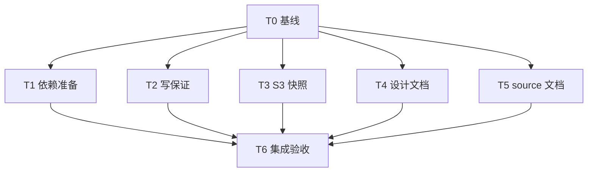

# rs-fs-testkit 本轮评审修复实施计划

> **面向智能体执行者：** 使用 executing-plans 技能逐项执行；如届时授权与适用技能要求采用子智能体，则按下列互斥写入集合调度。各步骤用复选框记录实际结果。本文只描述下一阶段工作，不表示这些工作已经执行。

**目标：** 以局部修正完成 FST-001 至 FST-005，保持公共 API、报告策略和下游接入方式。

**架构：** 保留 fixture、suite、公开门面三层结构。依赖清单转为项目维护；强化写复用已有有界载荷 helper；S3 快照不取得删除所有权；文档明确真实验证边界和 source 锁约束。

**技术栈：** Rust 2024 / Rust 1.94、Cargo、Python 3、现有 rs-infra、object_store InMemory、Tokio 测试宏。

**设计文档：** [本轮修复设计](design-20261102T064511682Z-3522f5e2.md)。项目根目录为 `/data/working/qubit/rust-common/rs-fs-testkit`。下面未带绝对路径的项目文件和命令均相对此根目录。

**文档位置：** 使用用户指定的项目 doc 路径，不创建临时设计工作区。实施验证可使用可丢弃文件系统沙箱，但它不是新的 Paseo workspace。

## 纳入范围与持续要求

采纳：FST-001（P1，依赖准备）、FST-002（P2，零上限写保证）、FST-003（P2，快照清理所有权）、FST-004（P2，设计承诺）、FST-005（P3，inspect Rustdoc）。无用户明确搁置或拒绝条目，无待验证疑点作为已确认缺陷纳入。

- 始终使用中文回复；项目生产 Rustdoc 保持英文。
- 当前 Paseo workspace 内处理，不创建或打开其他 Paseo workspace。
- 仅修改本轮直接相关内容，不顺手重构、格式化或清理。
- CI 只验证当前 crate；不得加入或保留 downstream all-features 测试。sibling 只作为构建依赖准备。
- 保留实施前既有暂存和未暂存内容，逐 hunk 判断本轮 diff。不得用整文件还原或基础设施全量更新丢弃它们。
- 提交、推送、发布的实际操作依据下一阶段命令授权；本计划本身不提供这些授权。

## 调度图

T1—T5 的文件集合互不重叠，属于同一可并行批次；依赖只在 T0 与 T6。工具可用性、实施授权和 agent 调度按届时技能执行，不为计划生成另建 workspace。表中的解锁产物是可审查工作树内容，不以提交为前提。

| 任务 | 前置任务 | 最小解锁产物 | 写入集合 | 本地验证 | 集成验证归属 | 审查时机 |
| --- | --- | --- | --- | --- | --- | --- |
| T0 基线 | 无 | 当前授权、status/diff、适用规则记录 | 无 | 只读核对 | T6 | 立即审查 |
| T1 依赖准备 | T0 | profile 所有权与 TSV 一致 | `.infra/bootstrap-update.toml`、`.infra/bootstrap-source.json`、`.infra/ci/local-path-dependencies.tsv` | snapshot 检查及 manifest 闭包核对 | T6 干净沙箱 | 立即审查 |
| T2 写保证 | T0 | 双驱动的有界载荷与回归 | 两份 `write_guarantee.rs`、两份 `*_io_contract_regression_tests.rs` | 两个 focused test 命令 | T6 | 立即审查 |
| T3 S3 快照 | T0 | 无副作用快照与 sentinel 回归 | S3 `tests/common/fixture.rs`、`tests/s3_listing_tests.rs` | focused InMemory test | T6 | 立即审查 |
| T4 设计文档 | T0 | 与代码一致的覆盖说明 | 中文既有设计；英文既有设计仅必要对应处 | 人工逐项语义核对 | T6 | 批量审查 |
| T5 source 文档 | T0 | 不可重入说明与安全例子 | `src/contract_source.rs`、`src/tests/contract_source_tests.rs` | focused 单元测试 | T6 doctest/strict-doc | 批量审查 |
| T6 集成 | T1、T2、T3、T4、T5 | 所有修改及局部验证记录 | 验证记录；仅必要的本轮格式修正 | 本节集成命令 | T6 唯一归属 | 立即审查 |

Cargo 重型命令归同一资源组 R-CARGO，串行运行，避免争抢 target/cache。T6 独占全量 CI、全量 fixture 测试和干净沙箱编译；叶子任务只跑 focused command。CI 已包含的测试、Clippy、Rustdoc、coverage 不再独立重复跑一套，除非失败或新改动要求重验。

## 任务拓扑依赖图



## T0：确认实施基线

- [ ] 读取下一阶段实施命令，确认实际允许的修改、验证及 Git 操作；不要把方案生成阶段的只编写文档要求沿用为实施禁令。
- [ ] 记录 `git status --short`、`git diff --stat`、`git diff --cached --stat`，按文件阅读与本轮重叠的 diff。当前已存在 `.infra/*`、两个 Cargo.lock、fixture manifest 和部分测试的用户改动，不能将它们视为本轮新增。
- [ ] 发现用户已经完成某项修正时，核对证据后复用，避免重复改动；有新增变化时调整行号定位，不改变 FST 范围。
- [ ] 源码和测试实施前读取 `~/.agents/specs/bug-fix.mdc`、`rust-coding.mdc`、`rust-comment.mdc`、`rust-test.mdc` 中适用条目及相关技能。确需编写 Shell 脚本或执行高风险 Shell 时读 shell.mdc；实际 Git 写操作前读 git.mdc。按当时 Rust 风格技能核实规范快照。

交付：基线和实际授权记录。无需新增项目文件，无其他任务接口。

## T1：将依赖准备清单转为项目维护（FST-001）

文件：`.infra/bootstrap-update.toml`、`.infra/bootstrap-source.json`、`.infra/ci/local-path-dependencies.tsv`。无公共接口变化，输出是 helper 可消费的三列 TSV。

- [ ] 读取根、`../rs-fs`、`../rs-redact` 及其 workspace 成员的 Cargo manifest，逐个确认解析需要的外部 path 路径；内部 `derive` 不需要另一个仓库。不得复制 rs-fs 自己的 CI 清单，因为它还含其他不必要仓库。
- [ ] 在最终工作树副本中复现“没有 sibling 时未能加载 ../rs-fs/Cargo.toml”；本机原目录中已有 sibling 不构成反例。复现与修复后的完整沙箱流程统一在 T6 执行，记录前后结果。
- [ ] 从 profile 数组只移除 `local-path-dependencies-default`；当前完整配置结果为：

```toml
profiles = []
```

- [ ] 从 bootstrap 快照的 `files` 对象只移除 `.infra/ci/local-path-dependencies.tsv` 的记录。这是移交配置所有权，不是修改自定义 TSV 的 sha256 以冒充上游版本；其余字段保持原样。
- [ ] 用真实 TAB 写清单，当前最低内容如下；只有前一步证明有其他外部 path 时才追加：

```text
# relative git root<TAB>repository URL<TAB>default branch
# Project-owned path-dependency closure; do not enable the empty default profile.
../rs-fs	https://github.com/qubit-ltd/rs-fs	main
../rs-redact	https://github.com/qubit-ltd/rs-redact	main
```

- [ ] 执行 `python3 .infra/bootstrap-check.py`，预期退出 0，且其他受管文件没有新增漂移。如果基线已有漂移，分别记录，不能通过更新无关摘要消除提示。
- [ ] 复核 profile 未再选择 TSV、快照不再管理 TSV，并对照现有 `sync.py:selected_entries` 规则确认更新后仍保留项目配置。若需实际 sync 验证，只在副本运行；原树不做全量基础设施升级。

审查：将三文件变更放在一起检查。最终干净环境验证归 T6。

## T2：强化写保证适配零上限（FST-002）

文件：`src/file_system_contract_suite/write_guarantee.rs`、`src/async_file_system_contract_suite/write_guarantee.rs`、`tests/sync_io_contract_regression_tests.rs`、`tests/async_io_contract_regression_tests.rs`。复用已有 helper：`bounded_payload(FileSystemLimit, &[u8], u8) -> Vec<u8>`；不新增公共接口。

- [ ] 向同步回归文件添加以下测试，沿用文件已有 imports：

```rust
#[test]
fn test_sync_write_guarantees_respect_zero_and_one_byte_limits() {
    for maximum in [0, 1] {
        for id in [ContractCheckId::WriteAtomicReplaceExisting, ContractCheckId::WriteDurable] {
            let limits = FileSystemLimits::unknown()
                .with_max_write_bytes(FileSystemLimit::Maximum(maximum));
            let fixture = MemoryFixture::with_limits(limits);
            let mut suite = FileSystemContractSuite::new(&fixture);
            let run = suite.run_check(id);
            run.assert_satisfied();
            let check = run.report().checks().iter().find(|check| check.id() == id)
                .expect("selected guarantee must have evidence");
            assert!(matches!(check.outcome(), ContractCheckOutcome::Passed));
        }
    }
}
```

- [ ] 向异步回归文件添加独立测试；确保 fixture 声明确实包含 AtomicReplace 和 DurableWrite：

```rust
#[test]
fn test_async_write_guarantees_respect_zero_and_one_byte_limits() {
    for maximum in [0, 1] {
        for id in [ContractCheckId::WriteAtomicReplaceExisting, ContractCheckId::WriteDurable] {
            let limits = FileSystemLimits::unknown()
                .with_max_write_bytes(FileSystemLimit::Maximum(maximum));
            let fixture = AsyncMemoryFixture::with_limits(limits);
            run_controlled(async {
                let mut suite = AsyncFileSystemContractSuite::new(&fixture);
                let run = suite.run_check(id).await;
                run.assert_satisfied();
                let check = run.report().checks().iter().find(|check| check.id() == id)
                    .expect("selected guarantee must have evidence");
                assert!(matches!(check.outcome(), ContractCheckOutcome::Passed));
            });
        }
    }
}
```

- [ ] 依次运行以下 focused commands；修改生产实现前，预期在 maximum=0 的强化写检查出现 ResourceLimitExceeded 相关失败。若未失败，查明 fixture 与 check 证据，不接受因能力缺失而没有执行的测试。

```bash
cargo test --locked --test sync_io_contract_regression_tests test_sync_write_guarantees_respect_zero_and_one_byte_limits
cargo test --locked --features async --test async_io_contract_regression_tests test_async_write_guarantees_respect_zero_and_one_byte_limits
```

- [ ] 在两份 write_guarantee 模块中分别导入 `super::write::bounded_payload`，将固定 `let bytes = b"b";` 替换为：

```rust
let payload = bounded_payload(
    self.context.properties().limits().max_write_bytes(),
    b"b",
    b'b',
);
let bytes = payload.as_slice();
```

其他准备、旧内容不同校验、Required 保证、计数和独立读取逻辑不变；不抽取跨驱动新模块。

- [ ] 再跑上述 focused commands，预期四种组合各自通过，且 check 结果均为 Passed。原有坏 provider 检测和全量 I/O 回归由 T6 的本 crate CI 执行。

## T3：S3 快照不登记删除所有权（FST-003）

文件：`fixtures/s3-contract/tests/common/fixture.rs`、`fixtures/s3-contract/tests/s3_listing_tests.rs`。使用现有 `Fixture::memory`、SDK 和 `AsyncFileSystemFixture`，不新增依赖。

- [ ] 在现有 s3_listing_tests 的 imports 基础上新增下列 InMemory 回归：

```rust
#[tokio::test]
async fn test_namespace_snapshot_does_not_claim_unowned_keys() {
    let fixture = common::Fixture::memory("snapshot-ownership");
    let sentinel = ObjectPath::from(format!("{}/sentinel", fixture.config.prefix));
    fixture.store.put(&sentinel, Bytes::from_static(b"keep").into()).await.unwrap();
    assert!(matches!(
        fixture.seed_file("owned", b"remove").await.unwrap(),
        FixtureSupport::Supported(_)
    ));
    let owned = ObjectPath::from(format!("{}/owned", fixture.config.prefix));
    for _ in 0..2 {
        let FixtureSupport::Supported(paths) = fixture.snapshot_namespace_paths().await.unwrap() else {
            panic!("namespace snapshot must be supported");
        };
        let mut names: Vec<_> = paths.iter().map(|path| path.as_str()).collect();
        names.sort();
        assert_eq!(names, vec!["owned", "sentinel"]);
    }
    for _ in 0..2 {
        fixture.teardown().await.unwrap();
        assert!(matches!(fixture.store.head(&owned).await, Err(object_store::Error::NotFound { .. })));
        let retained = fixture.store.get(&sentinel).await.unwrap().bytes().await.unwrap();
        assert_eq!(retained.as_ref(), b"keep");
    }
}
```

- [ ] 执行 focused test，预期修复前 sentinel 在 teardown 后 NotFound：

```bash
cargo test --locked --manifest-path fixtures/s3-contract/Cargo.toml --test s3_listing_tests test_namespace_snapshot_does_not_claim_unowned_keys
```

- [ ] 在 snapshot 的 namespace 边界校验后，将 `self.path(logical)` 替换为无副作用解析，保留 typed source：

```rust
Path::parse_literal(logical)
    .map_err(|error| FixtureError::with_source("snapshot logical path failed", error))
```

- [ ] 更新该方法注释，明确快照不取得删除所有权；保留 `path()` 登记和 teardown 失败重试机制。重新执行同一 focused command，预期退出 0。

## T4：修正文档覆盖与 fixture 职责（FST-004）

文件：`doc/file_system_testkit_design.zh_CN.md`；`doc/file_system_testkit_design.md` 仅在必要时补充对称说明。没有运行时接口变化。

- [ ] 对照 `src/internal/property_expectations.rs:check_snapshot` 和 `src/internal/assertions.rs` 阅读第 7、10、12 节；用代码中实际检查的字段和场景作为依据。
- [ ] 第 7 节移除 getter 无 I/O、clone snapshot 共享和 credential-like key 检查的正向覆盖承诺；保留并强化现有“黑盒不能证明这些保证”的责任说明。
- [ ] 第 10 节改为“在对应已执行的负面场景中校验结构化字段及保留的错误证据”，将逐操作格式化/错误链的普遍保证归于 core/provider，而不是 provider suite 已验证。
- [ ] 第 12 节区分 suite 自验证与 core/provider 故障测试责任，消除“清单中的全部 broken provider 都必须被 suite 捕获”的歧义；不得以新增 fault hook 兑现旧文案。
- [ ] 第 3.1 节将代码块注明为接口节选，并补入以下必需方法；职责文字说明独立、幂等、处理部分准备和 staging，Drop 不能替代：

```rust
fn teardown(&self) -> FixtureResult<()>;
```

- [ ] 第 3.2 节明确异步 teardown 同样必需，且 Drop 不做异步 I/O；核对英文设计的责任边界。现有 README 和用户指南事实正确，不为形式对齐改写。
- [ ] 人工核对每个正向承诺均有实现依据、每个排除项均有责任归属，中英文没有相反结论。此类文案修正不增加镜像关键字测试。

## T5：说明 inspect 不可重入及安全取出模式（FST-005）

文件：`src/contract_source.rs`、`src/tests/contract_source_tests.rs`。保留 `inspect<T>(&self, impl FnOnce(&(dyn Error + Send + 'static)) -> T) -> Option<T>` 与 `take(&self) -> Option<Box<dyn Error + Send>>`。

- [ ] 在 inspect 英文 Rustdoc 的返回值说明前补充：

```text
The callback runs synchronously while this source's mutex is held. It must
not directly or indirectly call inspect or take on the same source, or wait
for another operation that needs that mutex. Return the inspection result
first, then take the source outside the callback.
```

- [ ] 添加可编译 doctest helper，参数由调用者从失败链取得，不暴露 private 构造器：

```rust
use std::error::Error;
use qubit_fs_testkit::ContractSource;

fn take_io_source(source: &ContractSource) -> Option<Box<dyn Error + Send>> {
    let is_io_error = source.inspect(|error| error.is::<std::io::Error>())?;
    if is_io_error { source.take() } else { None }
}
```

示例下说明 inspect/take 之间非原子、并发方可先取走 source，调用者必须处理 None，并承担取出后的显式恢复责任。

- [ ] 在现有内部测试文件补充安全模式的可运行测试；不测试实际重入死锁：

```rust
#[test]
fn test_source_can_be_taken_after_type_inspection() {
    let source = ContractSource::new(std::io::Error::other("recoverable"));
    let is_io_error = source.inspect(|error| error.is::<std::io::Error>()) == Some(true);
    assert!(is_io_error);
    let owned = source.take().expect("source must transfer after inspection");
    assert!(owned.is::<std::io::Error>());
    assert!(source.take().is_none());
}
```

- [ ] 执行 `cargo test --locked --lib test_source_can_be_taken_after_type_inspection`，预期退出 0。该项为使用约束补文档，不声称此测试修复前会失败。doctest 与 strict-doc 统一由 T6 执行。

## T6：集成验收与报告

前置：T1—T5 已完成并经过局部审查。全量命令由本任务唯一执行；如最终格式化改变本轮代码，复核变更文件并补跑受影响定向测试。

- [ ] 审查最终 diff：五项均有对应产物，用户原有改动仍保留，无公共 API 或版本变化、无额外 downstream CI、无无关源码清理。按项目工具执行必要的风格整理，任何整仓格式工具先检查影响，避免带入无关格式 diff。
- [ ] 使用以下方式创建可丢弃的干净文件系统副本，复制的是当前工作树文件字节，不是遗漏未提交修复的 HEAD archive。该步骤不创建新的 Paseo workspace，也不移动已有 sibling：

```python
from pathlib import Path
import os
import shutil
import subprocess
import tempfile

original = Path('/data/working/qubit/rust-common/rs-fs-testkit')
sandbox = Path(tempfile.mkdtemp(prefix='fs-testkit-clean-'))
project = sandbox / 'rs-fs-testkit'
project.mkdir()
tracked = subprocess.check_output(
    ['git', 'ls-files', '--cached', '--others', '--exclude-standard', '-z'], cwd=original
)
for item in sorted(set(tracked.split(b'\0'))):
    if not item:
        continue
    relative = Path(os.fsdecode(item))
    source = original / relative
    if not source.is_file() or source.is_symlink():
        continue
    destination = project / relative
    destination.parent.mkdir(parents=True, exist_ok=True)
    shutil.copy2(source, destination)
print(project)
```

保留打印出的绝对路径供后续命令使用。临时副本中只有本项目，准备步骤才允许生成所需 sibling；不复制用户现有整个 workspace。可先对只含原空清单的副本运行 locked metadata，记录预期缺 path 的失败，再恢复为最终清单执行以下流程。

- [ ] 在副本根目录设置 `RS_INFRA_PROJECT_ROOT` 为该副本绝对路径，运行 `./.infra/bin/prepare-local-path-dependencies.sh`。确认只准备 TSV 中必要仓库；记录实际 revision。然后运行：

```bash
cargo metadata --locked --format-version 1
cargo check --locked --all-targets --all-features
```

预期退出 0，metadata 的本地 path packages 均位于沙箱内，root Cargo.lock 和 S3 Cargo.lock 的摘要不因验证变化。profile/snapshot 所有权调整保持一致；不能通过引用原 workspace 的 sibling 或去掉 `--locked` 掩盖失败。

- [ ] 回到目标项目根目录，串行执行本 crate 标准 CI：

```bash
./.infra/bin/ci-check.sh
```

记录 exit code 与实际任务清单，包括本 crate 的 feature matrix、strict-doc、README、coverage 等结果。CI 只验证当前 crate，不运行生态脚本来扩展 downstream all-features。

- [ ] 串行执行独立 fixture crate 的本地验证矩阵：

```bash
cargo test --locked --manifest-path fixtures/s3-contract/Cargo.toml --lib --test adapter_unit_tests --test s3_listing_tests --test s3_recovery_tests --test s3_inflight_put_tests --test s3_range_http_tests
```

预期退出 0；包含 namespace/sentinel 回归、InMemory supported matrix 与本地 HTTP 测试。真实 S3 服务 ignored tests 未执行，不声称远端后端已通过。

- [ ] 核对根 crate 和 S3 crate 的锁文件前后摘要、`git diff --check`、最终 status。发现新锁文件变化时先定位原因；不要覆盖或回退基线中已有的 lock diff。
- [ ] 汇报 FST-001—FST-005 的实现位置、失败到通过证据、实际命令和退出码、CI/环境限制及剩余项。失败与环境阻塞如实记录，不把“代码已写”当作已验收。临时沙箱如需清理，仅清理本任务创建且已确认可丢弃的目录。

## 设计覆盖与交付自检

| 设计必须项 | 任务 | 验收证据 |
| --- | --- | --- |
| 清单与 bootstrap 所有权同步，更新不重置 | T1、T6 | profile/快照/TSV 一致、snapshot 检查与沙箱构建 |
| 两个零上限强化写 check 实际 Passed | T2、T6 | 双驱动 maximum=0/1 定向结果及本 crate CI |
| 快照保留未登记对象，仍清理登记对象且幂等 | T3、T6 | sentinel/owned 双向断言及本地 fixture 矩阵 |
| 双语覆盖说明无冲突，必需 teardown 完整 | T4、T6 | 逐项语义核对与现有文档门禁 |
| inspect 锁约束、非原子取出与恢复责任明确 | T5、T6 | 英文 Rustdoc、安全路径单测及 doctest |
| 保留既有修改，CI 不扩展到 downstream | T0、T6 | 基线/最终 diff 和实际 CI 命令记录 |

调度表、拓扑图和任务列表统一使用 T0—T6；五项均有实施和验收归属。本文尚未执行任何实施步骤，后续执行者只能根据实际证据勾选。
